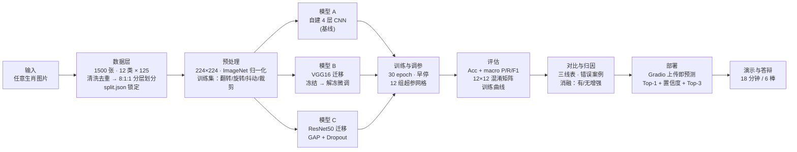

# 技术路线（报告 四.1 · 答辩第 1 棒）

## 一句话

**先定死一份数据，再用一条流水线跑三个模型，最后用同一张表说话。** 数据、划分、指标口径全程只允许有一个版本，所有结论都能回到日志里查。

## 路线图

## 五个环节的输入、输出与责任人

| 环节 | 输入 | 输出（可检查的产物） | 责任人 |
| --- | --- | --- | --- |
| 数据层 | 网络抓取 + 公开数据集补充 | `data/split.json`、类别分布图、来源清单 | B |
| 预处理 | 原始图 | 统一 224×224 RGB、增强流水线（只作用于训练集） | B |
| 模型层 | 划分好的数据 | 三个模型定义 + 参数量统计 | C / D |
| 训练与调参 | 模型 + 数据 | 权重 `models/*.pth`、日志 `results/logs/*.jsonl`、12 组调参记录 | C / D |
| 评估与部署 | 权重 + 测试集 | 指标表、混淆矩阵、曲线、Demo | E / F |

## 四个关键设计决策（老师一定会问"为什么"）

1. **为什么三个模型，而不是一个？**
   评分表写明"使用 2 个及以上经典卷积网络得 2 分，0–1 个只得 1 分"；更重要的是，只有对比才能讲出"迁移学习在小样本上到底带来多少增益"。自建 CNN 是下限参照，VGG16 是稳定主力，ResNet50 是"更深是否更好"的验证。

2. **为什么 8:1:1，而不是 7:1.5:1.5？**
   1500 张的规模下，验证集和测试集各 150 张已够做模型选择与最终评估；训练集保 1200 张，避免小样本下欠拟合。**分层抽样**保证每类在三个子集里的比例一致（每类 100 / 12 / 13 左右），否则小类别会被抽空。

3. **为什么先冻结再解冻微调？**
   数据只有 1500 张，全量微调容易把 ImageNet 学到的通用特征冲掉。冻结卷积层只训分类头（快速收敛、稳），再解冻后两层用小 10 倍学习率微调（提升细节判别力）。这个"两段式"本身就是方案设计的加分点。

4. **为什么指标用 macro-F1，而不是只看准确率？**
   12 类均衡时准确率已经够用，但老师会追问"哪类容易错"。macro 平均对每一类等权，能暴露少数难类（如龙/蛇细长体型、鼠/兔小目标）被平均掉的问题；配 12×12 混淆矩阵才讲得清错在哪。

## 与评分维度的对应

| 评分维度（分值） | 本路线里对应的部分 |
| --- | --- |
| 方案设计（25） | 路线图 + 数据方案 + 模型方案 + 指标口径，四小节各有产物 |
| 实验实施与结果（30） | 三个模型 × 12 组调参 + 消融 + 三线表 + 可复现脚本 |
| 分析与总结（15） | 混淆矩阵归因 + 错误案例 + "试过但没用"的记录 |
| 报告规范性（10） | 图表编号、术语统一、附录 A 分工表、附录 B AI 声明 |

## 风险与备选

- **数据抓不够 1500 张**：优先扩公开数据集（Kaggle 生肖/动物子集），并在报告里说明合并口径；这是硬指标，不能妥协。
- **GPU 不可用**：把 epoch 降到 15、batch 降到 16，先跑通链路再谈精度；答辩讲"我们在 CPU/单卡上的取舍"反而是加分项。
- **某个模型训崩**：保留失败日志，写进"尝试过但无效的方案"——这一条恰恰是评分标准里区分"真做过"与"抄结果"的关键。
