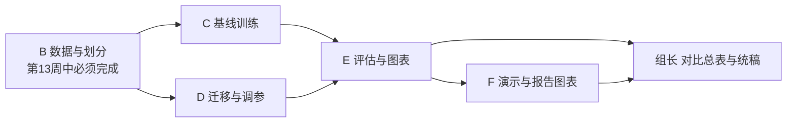

# 进度计划（四周倒排）

> 周次按 9 月 7 日开学估算，**请对照实际教学日历改日期**。若抽到第 14 周答辩，第 14 周任务整体前移一周。

## 一、里程碑

| 时间 | 里程碑 | 负责人 | 完成标志（做不到就是没完成） |
| --- | --- | --- | --- |
| 第 12 周 11/27–11/29 | 仓库与口径定稿、环境跑通、指定主训练机 | 组长 / C | 分工表发群确认；仓库首个 commit；`check_env.py` 出结果 |
| 第 13 周 11/30–12/6 | 数据 1500 张到齐并冻结；基线 CNN 出第一版准确率 | B / C | `split.json` 定版；基线测试集 Acc 记入日志；类别分布图出图 |
| 第 14 周 12/7–12/13 | 两个迁移模型 + 12 组调参完成；报告初稿 60%；第一次彩排 | D / E / 组长 | 调参表 ≥10 行；初稿交组长；六人各测一次时长 |
| 第 15 周 12/14–12/20 | 图表与分析定稿；Demo 公网可访问；第二次彩排 | E / F | 图 1–图 n 齐全且正文都引了；URL 手机能打开；六人全部 160–180s |
| 第 16 周 12/21–12/25 | 报告 PDF 定稿并提交（12/25 22:00 前） | 组长 | 邮件已发 + 回执截图；U 盘备份权重/演示视频 |

## 二、关键路径（谁挡住谁）

**只有一条关键路径：B 的数据 → C/D 的模型 → E 的图表 → 组长的定稿。** B 晚一天，全组晚一天，所以数据是最高优先级，允许 C、D 先用占位数据跑通代码。

## 三、每周站会（15 分钟，组长主持）

每人回答三句话：昨天做了什么 / 今天做什么 / 卡在哪。卡壳超过半天必须在群里说，不要自己闷三天。

## 四、应急方案

| 情况 | 处理 |
| --- | --- |
| 抽到第 14 周答辩 | 本周内完成数据与基线；答辩前两轮彩排；报告初稿降到"能讲清"即可 |
| 数据不够 1500 | 立即上报组长，扩公开数据集补齐；**不能少交**，这是硬指标 |
| GPU 排不上 | epoch 降到 15、batch 16 先跑通；答辩讲清取舍 |
| 某个模型训崩 | 保留日志写进"失败尝试"，不删记录 |
| 有人进度落后 | 组长当天介入，任务拆小或转交，但**讲述与报告章节不换人** |
